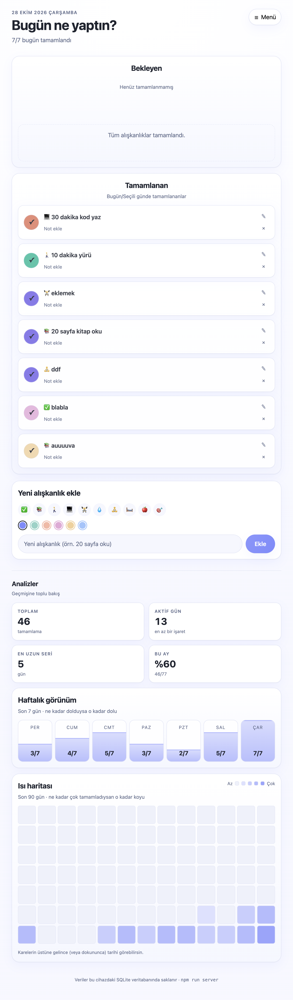
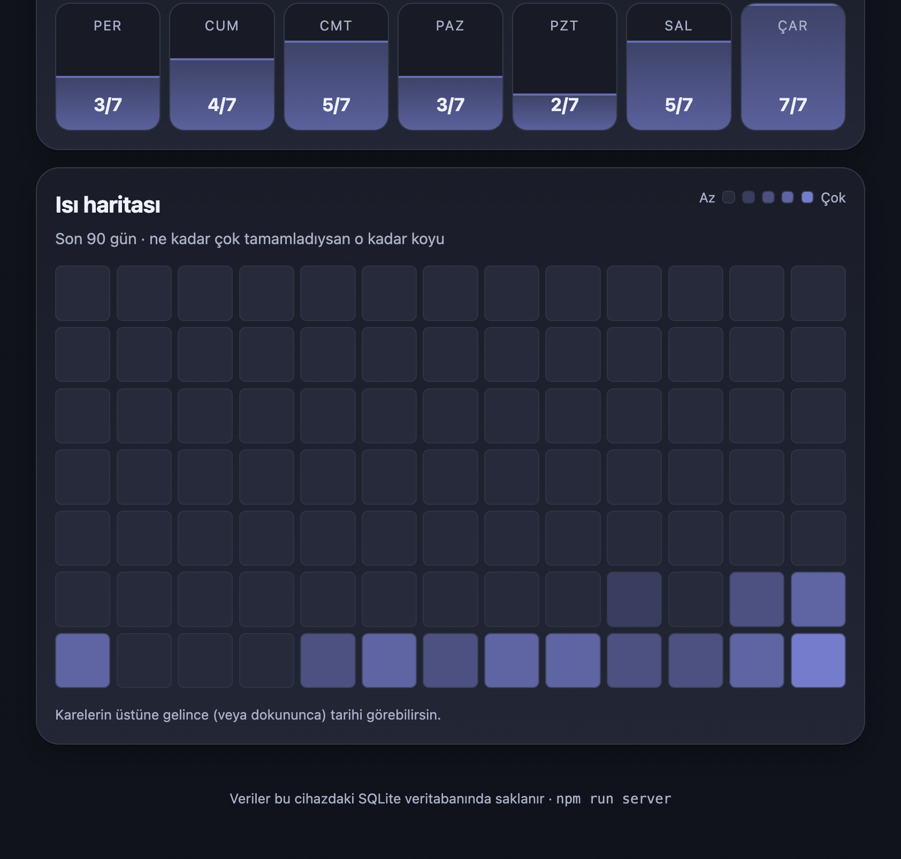

# Alışkanlık Takipçisi

Günlük alışkanlıklarını tek dokunuşla işaretle, serini ve istatistiklerini gör.
Vanilla JavaScript + Express + SQLite ile yazılmış, kurulabilir (PWA) bir web uygulaması.

| Açık tema | Koyu tema |
|---|---|
|  |  |

## Özellikler

- **İki sütunlu pano:** bekleyenler solda, tamamlananlar sağda
- **Seri (streak):** mevcut ve en uzun seri; geriye dönük işaretleme desteği
- **Analiz:** toplam tamamlama, aktif gün, bu ayki oran, haftalık "bardak" dolgusu, 90 günlük ısı haritası
- **Notlar:** tamamlanan kartlarda, tıklayınca açılır
- **Düzenleme / arşivleme:** isim, emoji, renk değiştirme; silmeden arşive alma ve geri getirme
- **Tema:** açık / koyu / sistem (sistem temasını canlı izler)
- **Yedekleme:** JSON indir / yükle (isim bazlı birleştirme, kopya üretmez)
- **PWA:** ana ekrana eklenebilir, çevrimdışıyken arayüz açılır
- **Geçmiş gün:** menüden tarih seçerek o günü işaretleme

## Mimari

```
index.html ──► js/app.js (arayüz, olaylar, render)
                    │
                    ├── js/stats.js, js/streak.js, js/date.js   (saf fonksiyonlar)
                    ├── js/theme.js, js/pwa.js                  (tema, service worker)
                    └── js/apiStore.js ──fetch──► /api/* ──► server/app.js ──► SQLite
```

Katmanların sırrı **sözleşme**de: `apiStore.js`, Aşama 0–2'de localStorage kullanan
`store.js` ile **aynı fonksiyon isimlerine** sahip. Arayüz hangi deponun kullanıldığını bilmez;
bu yüzden localStorage'dan sunucuya geçiş arayüzde neredeyse hiç değişiklik gerektirmedi.

**Türet, saklama:** veritabanında yalnızca `habits` ve `entries` var. Seri, oran, ısı haritası
her render'da bu iki tablodan hesaplanır. Böylece sayaçlar veriyle asla tutarsız kalmaz.

**Okuma senkron, yazma asenkron:** açılışta tüm durum bir kez çekilip bellekte tutulur
(snapshot), `render()` ağ isteği atmaz. Yazmalar `fetch` ile yapılır; sunucu başarılı derse
arayüz güncellenir — iyimser güncelleme yok, çünkü hata durumunda arayüz yalan söylememeli.

### Klasörler

| Yol | İçerik |
|---|---|
| `index.html`, `styles.css` | Arayüz ve tema değişkenleri |
| `js/` | Uygulama kodu (ES modülleri, build adımı yok) |
| `server/` | Express API + SQLite şeması |
| `tests/` | `node:test` ile birim + entegrasyon testleri |
| `scripts/` | İkon üretimi, yinelenen kayıt temizliği |
| `sw.js`, `manifest.webmanifest`, `icons/` | PWA katmanı |

## Çalıştırma

Gereken: **Node.js ≥ 24** (yerleşik `node:sqlite` için).

```bash
npm install
npm run server     # http://localhost:4173
npm test           # 64 test
npm run dev        # dosya değişince sunucuyu yeniden başlatır
```

Veritabanı `server/data/ht.db` dosyasında oluşur (git'e girmez).
Farklı bir yol için: `DB_PATH=/tmp/ht.db npm run server`.

## API

| Metot | Yol | Açıklama |
|---|---|---|
| GET | `/api/health` | Servis ayakta mı |
| GET | `/api/state` | Tüm durum (habits + archived + entries) |
| POST | `/api/habits` | Alışkanlık ekle |
| PATCH | `/api/habits/:id` | İsim / emoji / renk güncelle |
| DELETE | `/api/habits/:id` | Arşivle (soft delete) |
| POST | `/api/habits/:id/restore` | Arşivden geri getir |
| PUT | `/api/entries/:habitId/:date` | Günü işaretle / not yaz |
| GET | `/api/export` | JSON yedek |
| POST | `/api/import` | Yedekten birleştir |

## Yayın

İki parça ayrı yerde çalışır:

| Parça | Yer | Neden |
|---|---|---|
| Arayüz (statik) | GitHub Pages | Ücretsiz, HTTPS, CDN |
| API (Node + SQLite) | Render | Sürekli çalışan süreç + dosya sistemi gerekir |

Arayüz `js/config.js` içinde ortamı algılar: `localhost`/`127.0.0.1` ise aynı origin'e,
başka her yerde yayındaki API'ye istek atar. Build adımı olmadığı için ortam değişkeni yok;
bu yüzden API adresi kodda sabit. (Build eklenirse `import.meta.env.VITE_API_URL` olurdu.)

### Ortam değişkenleri (API)

| Değişken | Varsayılan | Açıklama |
|---|---|---|
| `PORT` | `4173` | Render kendi portunu verir |
| `HOST` | `127.0.0.1` (`PORT` varsa `0.0.0.0`) | Dinlenecek adres |
| `DB_PATH` | `server/data/ht.db` | SQLite dosyası |
| `ALLOWED_ORIGINS` | yerel + Pages adresi | Virgülle ayrılmış CORS listesi |

### CORS hakkında

CORS bir **sunucu güvenliği** değil, **tarayıcı politikası**dır. Sunucu yalnızca
"şu origin'e izin veriyorum" başlığını ekler; uygulama kararı tarayıcı verir.
`curl` ile her origin'den veri okunabilir — bu yüzden gerçek koruma için kimlik doğrulama gerekir.

### Bilinen sınırlar

- **Ücretsiz katman kalıcı disk sunmaz.** Render'ın ücretsiz servisi yeniden başladığında
  SQLite dosyası sıfırlanır. Kalıcı veri için ücretli disk veya yönetilen bir veritabanı gerekir.
  Bu yüzden JSON yedekleme (Aşama 4) sadece bir kolaylık değil, **veri sahipliği** aracıdır.
- **Soğuk başlangıç:** ücretsiz servis 15 dakika hareketsizlikten sonra uyur; ilk istek ~30–60 sn sürebilir.
- **Kimlik doğrulama yok.** Tek kullanıcılık, kişisel kullanım varsayımı.

## Yol haritası

Aşama aşama ne yapıldığı ve kazanımlar: [ROADMAP.md](ROADMAP.md)
